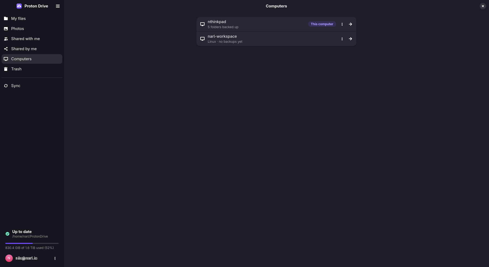

# Computers

Every computer that backs up folders to your account has its own entry in Proton Drive. The
**Computers** page lists this computer and every other one, including computers that run the
official Windows or macOS app.

- [What you can do](#what-you-can-do)
- [Syncing several computers](#syncing-several-computers)
- [Replacing or reinstalling a computer](#replacing-or-reinstalling-a-computer)

## What you can do

**On this computer:**

- See its synced folders and their state, and add more with **Add Folder to Sync**. See
  [Synced folders](SYNCED_FOLDERS.md).
- **Restore Folders…** brings back folders that are backed up under this computer but not synced
  here yet, for example after a reinstall.

**On another computer**, from its menu:

| Choose | When | What happens |
|---|---|---|
| **Browse Files** | You need a file from it | Its backup opens read-only, like My files |
| **Restore to This Computer…** | You want a copy of its folders here | Its folders download here and stay part of its backup |
| **Sync With This Computer…** | Both computers should share the same folders, such as a desktop and a laptop | Both keep the folders in step. See [below](#syncing-several-computers) |
| **Continue This Backup Here…** | This computer replaces it, after a reinstall or with new hardware | This computer takes over its backup. See [Recovery](RECOVERY.md) |
| **Move to This Computer…** | You switch for good, for example from Windows to Linux | Its folders move into this computer's backup and are offered for syncing here. The other computer stays in the list, without those folders |

`pdfs devices list` shows the same computers with their IDs, for the commands in the
[command-line reference](CLI.md#computers).

## Syncing several computers

Two or more computers can sync the same folders through one backup in Proton Drive.

1. Sync the folders on the first computer as usual.
2. On the second computer, open **Computers**, open the menu of the first computer and choose
   **Sync With This Computer…**. From a terminal: `pdfs devices join UID`, with the ID from
   `pdfs devices list`.
3. Choose which of its folders to sync here, and where.

From then on, both computers sync into that backup:

- A folder you add later on either computer lands there too. A folder with the same name joins
  the one already there.
- A change on one computer reaches the other within about two minutes.
- When both computers change the same file within that time, each keeps the other's version under
  the original name, and its own as a conflict copy named after it. See
  [Conflicts](SYNCED_FOLDERS.md#conflicts).

Folders that were synced on this computer before it joined stay in its own backup.

## Replacing or reinstalling a computer

Your synced folders are on Proton Drive, so a new or reinstalled computer can pick up where the
old one stopped. [Recovering on a new computer](RECOVERY.md) walks through it step by step, and
explains what is lost with a machine and what is not.
