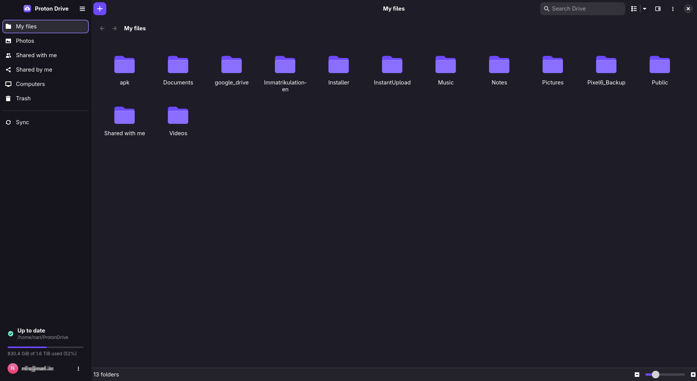

# Files and offline access

Your Proton Drive appears on this computer as a folder, `~/ProtonDrive`. Every file and folder in
it is listed straight away, but a file only downloads when a program opens it. This page covers
working in that folder, keeping files on this computer, the Trash, and earlier versions of a
file.

- [Your Drive as a folder](#your-drive-as-a-folder)
- [Keep files available offline](#keep-files-available-offline)
- [Browse in the app](#browse-in-the-app)
- [Trash](#trash)
- [Earlier versions of a file](#earlier-versions-of-a-file)
- [Choose which program opens a file](#choose-which-program-opens-a-file)

## Your Drive as a folder

`~/ProtonDrive` is your Proton Drive, called **My files** in the app. It is not a copy. A file you
change there changes on Proton Drive, and a file you delete there goes to the Proton Drive
Trash. Every program can use it, from your file manager to a terminal.

- **Only what you read is downloaded.** A video player that seeks, or a tool that reads only the
  start of a file, downloads only those parts. Videos and music start playing before the whole
  file is down.
- **Changes are instant, online or offline.** Creating, renaming, moving and deleting return at
  once. When a program saves and closes a file, the new content is stored on this computer and
  sent to Proton Drive in the background. Changes survive a lost connection, a crash or a reboot.
  See [Changes waiting for Proton Drive](SYNCED_FOLDERS.md#changes-waiting-for-proton-drive).
- **Recently opened files are cached** up to a size limit (5 GiB by default, set in
  **Preferences → Storage**). The oldest are removed first to make room.
- **Shared with me** is a folder inside `~/ProtonDrive` that holds what other people share with
  you. Shares where you are a viewer are read-only.

Proton Drive cannot store symbolic links, hard links, device files or FIFOs. A program that tries
to create one gets an error at once. For a project that needs them, use a
[synced folder](SYNCED_FOLDERS.md) and exclude those paths.

To move the folder somewhere else, change **Preferences → General → Location**.

## Keep files available offline

Files you mark **Available offline** are downloaded completely and stay on this computer, so
they open without a connection.

- **In the app:** select a file or folder in **My files** and turn on **Available offline**.
- **From a terminal:** `pdfs pin ~/ProtonDrive/Documents/Taxes`

For a folder, every file in it and in its subfolders downloads in the background. The tray and
the app show the progress. **Preferences → Storage → Available offline** and `pdfs pins` list
what is kept.

Turn it off again with the same switch, or `pdfs unpin PATH`. This frees the space. The files stay
on Proton Drive. A file inside a folder that is kept offline stays with its folder: turn the
folder off instead.

## Browse in the app

The **My files** page shows the same files without going through the folder. It has a grid and
a list view, sorting, thumbnails (including camera RAW previews), multi-select, and drag and drop
to upload. **Details** (Alt+Enter) shows the size, dates, sharing and version history of the
selected item.

Right-click an item for more. **Make a Copy** copies it into the same folder, and **Copy To…**
copies it, or a whole selection, into another folder in My files. The copy is made on Proton
Drive, so nothing is downloaded or uploaded, and a name already taken gets a " (1)" suffix. An
item with changes that have not reached Proton Drive yet can be copied once they have. From a
terminal: `pdfs copy PATH... NEW_PARENT`.

## Trash

Deleted files go to the Trash, both from `~/ProtonDrive` and from the app. The **Trash** page
lists them with the date they were deleted.

- **Restore** puts an item back where it was, together with any trashed folders above it.
- **Delete Forever** and **Empty Trash** are permanent.

From a terminal: `pdfs trash` lists the Trash with an ID for each item, and `pdfs restore`,
`pdfs delete-forever` and `pdfs empty-trash` take those IDs.

## Earlier versions of a file

Proton Drive keeps earlier versions of every file. Open them with **Details → Versions…** in the
app, or `pdfs versions list PATH`. You can:

- **Restore** a version. This happens on Proton Drive, so nothing is uploaded again.
- **Save** a version to a separate file, without touching the current one.
- **Delete** an old version permanently. The current version cannot be deleted.

## Choose which program opens a file

The app and the search launcher open files with your desktop's default program (`xdg-open`). To
open some file types differently, for example text files in Neovim inside a terminal, add
`open_with` rules to `config.json`. See [Configuration → `open_with`](CONFIGURATION.md#open_with).
