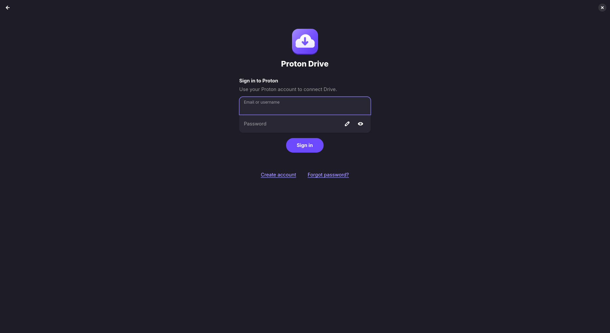

# Getting started

From installing to your first synced folder in a few minutes.

> [!IMPORTANT]
> Proton Drive for Linux is an unofficial client, built by the community and not by Proton. Try it
> first with files you also have somewhere else.

## 1. Install

| Distribution | Command |
|---|---|
| Fedora 44 or newer | `sudo dnf copr enable narl-rs/proton-drive-linux` `sudo dnf install proton-drive-linux` |
| Arch Linux | `paru -S proton-drive-for-linux` (or any other AUR helper) |
| Debian, Ubuntu 24.04 or newer | Download the `.deb` from the [latest release](https://github.com/narrrl/proton-drive-linux/releases/latest), then `sudo apt install ./proton-drive-linux_*_amd64.deb` |
| NixOS | See [Installation → NixOS](INSTALL.md#nixos-flake) |

On GNOME, also install the
[AppIndicator extension](https://extensions.gnome.org/extension/615/appindicator-support/) to see
the tray icon. [Installation](INSTALL.md) has every option, building from source, and the optional
extras.

## 2. Sign in

1. Open **Proton Drive** from your applications menu.
2. Sign in with your Proton email and password, and the two-factor code if your account has one.
   If Proton asks you to prove you are human (common on a VPN), solve the challenge in the window
   that opens.
3. Wait a moment. Your Proton Drive appears as the folder `~/ProtonDrive`.

The app starts the Proton Drive service for you, and the service starts by itself whenever you
log in. Your session is kept in the system keyring (GNOME Keyring, KWallet or KeePassXC), so you
sign in only once.

## 3. Choose how files are kept

There are three ways to have your files on this computer. You can mix them freely.

| | Takes disk space | Works offline | Use it for |
|---|---|---|---|
| **Online only** (the default in `~/ProtonDrive`) | Only for files you opened recently | Only files still in the cache | Most of your Drive: archives, media, anything large |
| **Available offline** | Yes | Yes | Files and folders you need on the road |
| **Synced folder** | Yes, a full copy | Yes | Folders that live on this computer, such as `~/Documents`, backed up to Proton Drive |

- **Online only:** open `~/ProtonDrive` in your file manager. Files download when you open them.
- **Available offline:** select a file or folder in the app and turn on **Available offline**.
  [More about offline files](FILES.md#keep-files-available-offline).
- **Synced folder:** in the app, open **Computers** and choose **Add Folder to Sync**.
  [More about synced folders](SYNCED_FOLDERS.md).

## 4. Know where to look

- **Tray icon:** shows whether everything is up to date, and pauses or resumes sync.
- **Sync → Overview** in the app: what is uploading, what is waiting, and anything that needs you.
- **Search launcher:** bind `pdfs-prompt` to a keyboard shortcut to find any file in Proton Drive
  or your home folder. See [Search launcher and tray](LAUNCHER_AND_TRAY.md).

> [!WARNING]
> `~/ProtonDrive` is your Proton Drive, not a copy. Deleting a file there moves it to the Proton
> Drive Trash on every device. You can restore it from **Trash** in the app.

## Next steps

- [User guide](USER_GUIDE.md): everything the app, tray and launcher do.
- [FAQ](FAQ.md): short answers to common questions.
- [Troubleshooting](TROUBLESHOOTING.md): when something does not work.
- [Recovering on a new computer](RECOVERY.md): read this before you rely on the client for
  backups.
- Prefer a terminal? `pdfs status` shows the state of everything, and the
  [command-line reference](CLI.md) lists every command.
