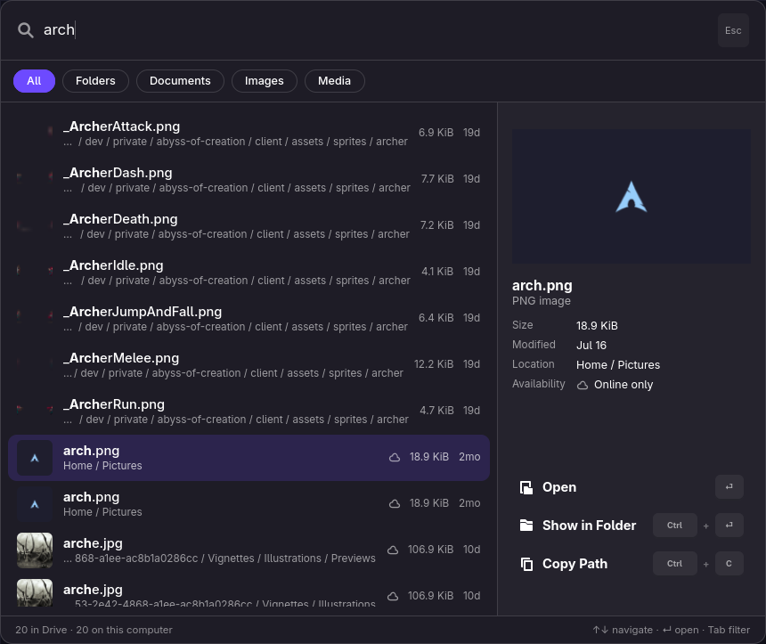
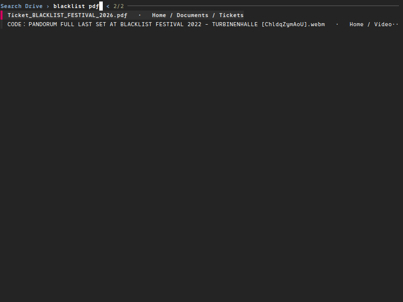

# Search launcher and tray

The search launcher finds files in Proton Drive and in your home folder from a keyboard shortcut.
The tray icon shows whether everything is up to date and gives quick access to the app.

- [Search launcher](#search-launcher)
- [Using your own launcher](#using-your-own-launcher)
- [Search as you type with fzf](#search-as-you-type-with-fzf)
- [Tray](#tray)

## Search launcher



`pdfs-prompt` searches Proton Drive and your home folder together, in one list with the best
matches first. It copes with prefixes, abbreviations, typos and swapped letters, and also matches
the names of parent folders.

To set it up, bind `pdfs-prompt` to a keyboard shortcut in your desktop's settings.

The window stays loaded after the first use, so later shortcuts open it instantly. Folders, music
and videos open straight from `~/ProtonDrive`, so players can start before the whole file is down.
Other files from Proton Drive download first, then open.

To make even the first shortcut instant, start the launcher hidden when you log in.
`pdfs-prompt --preload` loads the window without showing it, and does nothing if the launcher is
already running. For example, in Hyprland:

```ini
exec-once = pdfs-prompt --preload
bind = SUPER, space, exec, pdfs-prompt
```

Which program opens a file can be changed per file type. See
[Choose which program opens a file](FILES.md#choose-which-program-opens-a-file).

## Using your own launcher

`pdfs-prompt --dmenu` shows the results in fuzzel, rofi, wofi, tofi, bemenu or dmenu, whichever is
installed:

```bash
pdfs-prompt --dmenu
pdfs-prompt --dmenu --menu 'fuzzel --dmenu --width 60'
pdfs-prompt --dmenu --query invoice
```

These launchers filter a fixed list and cannot ask for new results while you type, so the search
takes two steps:

1. The first list, `Search Drive ›`, shows your available-offline files. Type a search and press
   Enter.
2. The second list, `Drive: invoice ›`, shows the results. Enter opens one. Typing something else
   searches again.

## Search as you type with fzf



`pdfs-prompt --fzf` searches again on every key press, like the built-in window. It needs `fzf`.
Started from a keyboard shortcut, it opens a terminal by itself (foot, ghostty, kitty, alacritty,
wezterm or xterm) with the app ID `pdfs-prompt`, so one window rule covers all of them. For
example, in Hyprland:

```ini
windowrulev2 = float, class:^(pdfs-prompt)$
windowrulev2 = size 900 500, class:^(pdfs-prompt)$
windowrulev2 = center, class:^(pdfs-prompt)$
bind = SUPER, space, exec, pdfs-prompt --fzf
```

To make `--dmenu` or `--fzf` the default without changing your shortcut, set `prompt.mode` in
`config.json` (see [Configuration → `prompt`](CONFIGURATION.md#prompt)). `--gtk` always opens the
built-in window.

## Tray

`pdfs-tray` starts when you log in and shows whether your files are up to date, syncing, paused or
offline. Its menu opens the app or `~/ProtonDrive`, pauses or resumes sync, and stops or connects
the service.

- **GNOME** shows tray icons only with the
  [AppIndicator extension](https://extensions.gnome.org/extension/615/appindicator-support/).
  KDE Plasma and most other desktops show it without help.
- **Hide Tray Icon** in its menu removes it until you turn it back on under
  **Preferences → General → Appearance → Show tray icon**.
