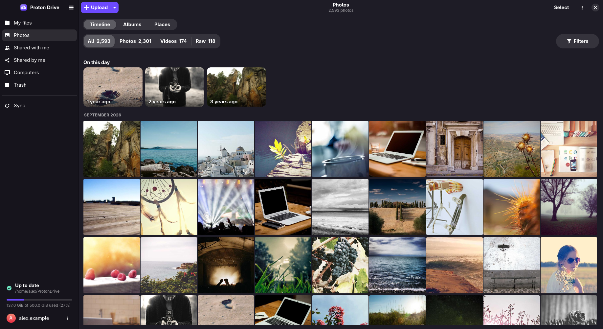
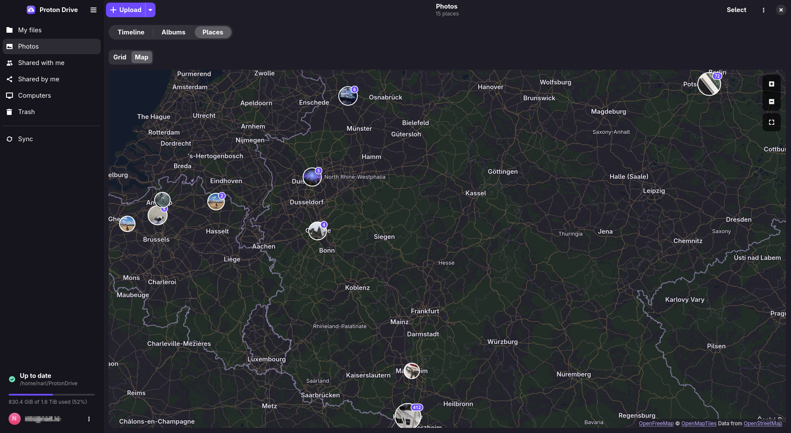

# Photos

The **Photos** page of the app shows your Proton Photos library. Photos are stored apart from
My files, so they do not appear in `~/ProtonDrive`.

- [Timeline](#timeline)
- [Albums](#albums)
- [Places](#places)
- [Viewer and duplicates](#viewer-and-duplicates)
- [Importing from Google Photos](#importing-from-google-photos)
- [Fixing photos filed under the wrong date](#fixing-photos-filed-under-the-wrong-date)



## Timeline

- The timeline groups photos by day, month or year as you zoom. Drag the scrubber on the right
  edge to jump through the years.
- **On this day** shows photos taken on the same date in earlier years.
- **Filters** narrow the timeline to images, videos or RAW files, to favorites, or to photos that
  are in no album.
- **RAW + JPEG pairs** of the same shot show as one tile. The viewer switches between the two, and
  moving the tile to the Trash removes both.
- **Upload** adds photos from this computer.

## Albums

**Albums** lists your own albums and the albums others share with you. Create, rename and delete
albums, and add or remove photos. Deleting an album keeps its photos in the timeline.

## Places



**Places** groups photos by the town they were taken in, as cards or on a map. Town names come
from [GeoNames](https://www.geonames.org/) data (CC BY 4.0) and the map from
[Natural Earth](https://www.naturalearthdata.com/) (public domain). Both ship with the app, so
nothing is fetched online.

A street map from [OpenFreeMap](https://openfreemap.org/) (© OpenStreetMap contributors) can be
turned on under **Preferences → General → Appearance**. It is off by default, because the map
server learns which areas you look at.

## Viewer and duplicates

- The viewer marks favorites, shows EXIF details, shows a photo on the map, and runs a slideshow
  (F5).
- **Find Duplicates…** in the page menu lists byte-identical copies. Turn on **Similar** to also
  find resized or re-encoded copies and burst shots.

## Importing from Google Photos

1. Request a [Google Takeout](https://takeout.google.com/) export of Google Photos and download
   every `.zip` of it.
2. In the app, open the **Upload** menu on the Photos page and choose **Import from Google
   Photos…**. Select all the `.zip` files at once, because a photo and its details are often in
   different parts of the export.

From a terminal:

```bash
pdfs import-google-photos --dry-run ~/Downloads/takeout-*.zip   # show what would happen
pdfs import-google-photos --wait ~/Downloads/takeout-*.zip
```

The import recreates your albums and takes capture dates and locations from the export. Photos
already in your library are skipped, so an interrupted import can simply be run again.
`pdfs import-status` shows how far an import is, and `pdfs cancel-import` stops it.

## Fixing photos filed under the wrong date

Photos from an earlier import sometimes sit under the day they were uploaded instead of the day
they were taken. `pdfs redate-photos --dry-run` finds those whose file name carries a different
date, and `pdfs redate-photos` fixes them.

Proton cannot change a capture date in place. So each fix uploads the photo again with the right
date and moves the original to the Trash. Favorites and albums are kept.
