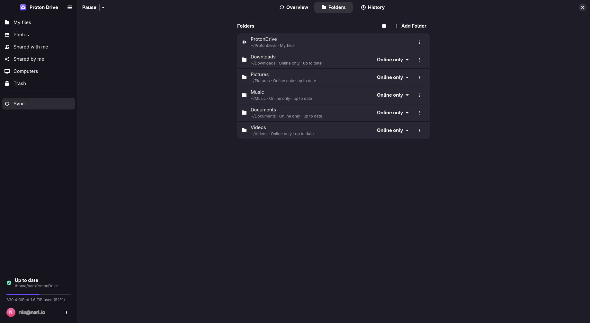
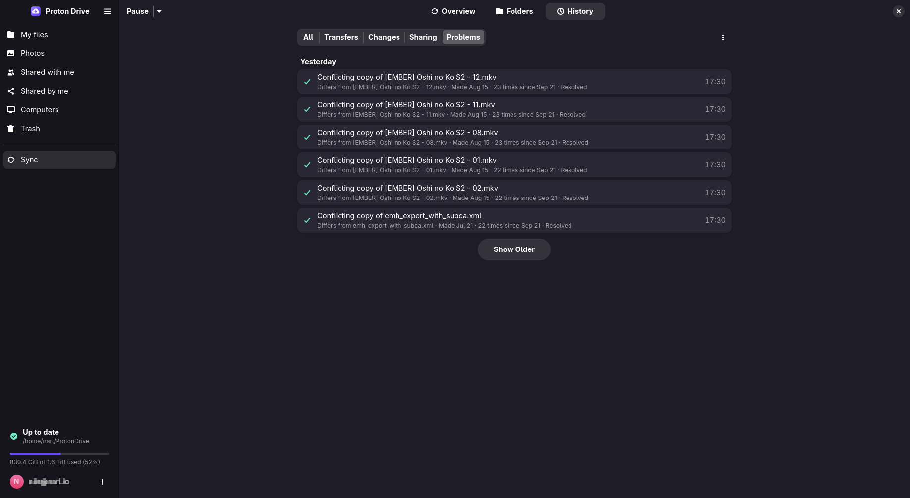

# Synced folders

A synced folder is an ordinary folder on this computer, for example `~/Documents`, that is backed
up to Proton Drive and kept in step with it. This page covers adding one, what to do with files
that should not be backed up, changes that are still waiting to upload, conflicts, and pausing.

- [Add a folder](#add-a-folder)
- [Synced or online only](#synced-or-online-only)
- [Move files between synced folders and My files](#move-files-between-synced-folders-and-my-files)
- [Stop syncing a folder](#stop-syncing-a-folder)
- [Excluding files with `.pdfsignore`](#excluding-files-with-pdfsignore)
- [Changes waiting for Proton Drive](#changes-waiting-for-proton-drive)
- [Conflicts](#conflicts)
- [Pausing and limiting sync](#pausing-and-limiting-sync)



## Add a folder

- **In the app:** open **Computers** and choose **Add Folder to Sync**.
- **From a terminal:** `pdfs sync add ~/Documents`

The folder is backed up under this computer's name. It shows on the **Computers** page of the app
and in the Proton Drive web app.

From then on, changes go both ways:

- A file you change here uploads a few seconds after the program closes it. A file that a
  program still holds open for writing waits until it is closed.
- A file changed somewhere else downloads on the next sync pass.

**Sync → Folders** in the app, and `pdfs sync list`, show every synced folder and its state.

To sync the same folders on two computers, see [Syncing several computers](COMPUTERS.md#syncing-several-computers).

## Synced or online only

A synced folder normally keeps a full copy on this computer. You can switch it to **Online
only**: the files stay visible in the same place, but take no disk space until you open them, the
same as in `~/ProtonDrive`.

- **In the app:** use the **Synced / Online only** switch on the folder's card.
- **From a terminal:** `pdfs sync mode ID ondemand`, and `pdfs sync mode ID mirror` to switch
  back. `pdfs sync list` shows the ID.

The switch waits until everything in the folder is on Proton Drive. It refuses while the folder
holds something that never goes there, such as an excluded `.git/` folder, a symbolic link, or a
folder you may not read. The message names what is in the way.

`pdfs locations` lists every place on this computer the Proton Drive service uses.

## Move files between synced folders and My files

`~/ProtonDrive`, each online-only folder and each synced folder are separate places for your
system. Moving a file between them with `mv` or a file manager copies and then deletes: every file
is downloaded, uploaded again, and the original goes to the Trash.

Use **Move to…** in the app or `pdfs move` instead. The move happens on Proton Drive and takes
seconds, whatever the size:

```sh
pdfs move ~/Documents/Scans ~/ProtonDrive/Archive
pdfs move ~/Documents/a.pdf ~/Documents/b.pdf ~/ProtonDrive/Archive
```

The last path is the destination folder. Everything before it moves there.

A move out of a synced folder waits until its files are on Proton Drive. A file that is still
uploading, has changes that are not uploaded yet, or is excluded by `.pdfsignore` stops the move,
and the message names it. Files you already opened in an online-only folder are not downloaded
again when they move into a synced one.

## Stop syncing a folder

**Stop Syncing** in the app, or `pdfs sync rm ID`, keeps both the local files and the copy on
Proton Drive. To delete the copy on Proton Drive as well, tick **Also delete from Proton Drive**,
or add `--delete-remote`.

## Excluding files with `.pdfsignore`

Synced folders skip build output, dependency folders and editor leftovers. Two sets of rules
apply together:

1. A `.pdfsignore` file at the top of the synced folder (`.protonignore` works too). It uses the
   same syntax as `.gitignore`, including `!` to include something again:

   ```gitignore
   build/
   *.log
   !important.log
   ```

2. The `ignore_patterns` list in `config.json`, for every synced folder (see
   [Configuration](CONFIGURATION.md#ignore_patterns)). When you have not set it, it skips
   `.git/`, `.hg/`, `.svn/`, `node_modules/`, `target/`, `.venv/`, `__pycache__/`, `*~`,
   `*.swp`, `*.tmp`, `.DS_Store` and `Thumbs.db`.

Rules are read again on every sync pass. Excluding never deletes anything: a file that becomes
excluded is no longer synced, and its copy on Proton Drive stays.

A folder you may not read, such as a cache that a container created as root, is skipped the same
way, and the activity feed mentions it once. Add it to `.pdfsignore` to stop the message.

## Changes waiting for Proton Drive

A change you make exists only on this computer until it reaches Proton Drive. `pdfs status`, the
tray and **Sync → Overview** count what is still waiting, and `pdfs sync queue` lists it.

Sometimes Proton Drive refuses a change: the storage is full, a share was taken away, the folder
is gone, the folder holds too many items, or Proton Drive does not accept the name. The change
then needs you. It shows at once in **Sync → Overview**, in the tray and in `pdfs sync issues`,
with what it means and what you can do. The file or folder also gets a warning badge in
**Files**. Hover over it to see why.

Nothing is deleted. The change stays queued and is tried again. You can:

- **Retry** it now, for example after freeing space: the same list, or `pdfs sync retry`.
- **Export** a file's content to keep your version: `pdfs sync export ID FILE`.
- **Discard** the change: `pdfs sync discard ID`. It is undone here and never sent. A new file or
  folder goes away, and anything else goes back to what Proton Drive has. Export first if you want
  to keep the content.

Two cases are not refused, and the activity log records both:

- A new file or folder whose name is already taken on Proton Drive, by something this computer
  had not seen yet, lands under a `(sync-conflict …)` name. See [Conflicts](#conflicts).
- A new file whose folder was deleted on another device in the meantime lands at the top of My
  files, so its content is not lost.

> [!IMPORTANT]
> Before you switch off or wipe a computer for good, check that nothing is waiting. Changes that
> have not reached Proton Drive are lost with the machine. See
> [Recovery](RECOVERY.md#lost-with-the-machine).

## Conflicts



When the same file changed on this computer and somewhere else since the last sync, neither
version is thrown away:

- The other version keeps the original name.
- Your local version is kept as a copy named like
  `report (sync-conflict laptop 1759068180).odt`. `laptop` is the computer that made the copy,
  and the number is the time of the conflict. Copies made before 3.5.0 have no computer name.

Conflicts show under **Sync → Overview → Needs attention** and in `pdfs conflicts`. For each one,
keep the original, keep the copy, or keep both under a new name:

```bash
pdfs conflicts
pdfs conflicts resolve "Documents/report (sync-conflict laptop 1759068180).odt" --keep copy
```

The version you do not keep goes to the Trash, so a wrong choice can be undone.

## Pausing and limiting sync

- **Pause** from the tray, the **Sync** page, or `pdfs sync pause`. Uploads and synced folders
  wait, and opening files keeps working. `pdfs sync pause --for 1h` resumes by itself, and
  `pdfs sync resume` continues at once.
- **Limit bandwidth** under **Preferences → General → Network**, or with
  `pdfs sync limit --up 2M --down 10M`. `0` removes a limit.
